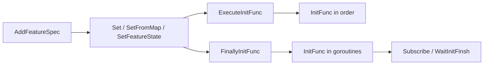

# FeatureGate

[English](README.md) | [中文](README.zh.md)

[](https://github.com/RealAlexandreAI/featuregate/actions/workflows/ci.yml)
[](go.mod)
[](LICENSE)

A small Go feature-flag gate, extracted from [`pkg/featuregate`](https://github.com/mosn/mosn) in [MOSN](https://github.com/mosn/mosn). It keeps named feature specs, their defaults, and an optional lock-to-default, then runs each spec's `InitFunc` either in order or in the background.

There is no config file, no network call, and no process-wide `init()`. You construct a `FeatureGate`, register specs, set state, then start init yourself.

Module: `github.com/RealAlexandreAI/featuregate` (latest tag `v0.0.1`). Go 1.22.

## How it runs



`ExecuteInitFunc` is synchronous and only touches the keys you pass. `FinallyInitFunc` switches the gate to the finally stage and starts a goroutine for every enabled spec that has not already finished. `Subscribe` is legal only after that switch.

## Install

```bash
go get github.com/RealAlexandreAI/featuregate@v0.0.1
```

## Usage

```go
package main

import (
	"fmt"
	"time"

	"github.com/RealAlexandreAI/featuregate"
)

type onFeature struct {
	featuregate.BaseFeatureSpec
	name string
}

func (f *onFeature) InitFunc() {
	fmt.Println("init", f.name)
}

func main() {
	fg := featuregate.NewFeatureGate()

	_ = fg.AddFeatureSpec("alpha", &onFeature{
		BaseFeatureSpec: featuregate.BaseFeatureSpec{DefaultValue: true},
		name:            "alpha",
	})
	_ = fg.AddFeatureSpec("beta", &onFeature{
		BaseFeatureSpec: featuregate.BaseFeatureSpec{DefaultValue: false},
		name:            "beta",
	})
	_ = fg.AddFeatureSpec("locked", &featuregate.BaseFeatureSpec{
		DefaultValue:    false,
		IsLockedDefault: true,
	})

	// Unknown names and values that are not booleans return an error.
	// A spec with IsLockedDefault set refuses a value other than DefaultValue.
	if err := fg.Set("alpha=true,beta=true"); err != nil {
		panic(err)
	}

	fmt.Println(fg.Enabled("alpha")) // true
	fmt.Println(fg.Enabled("beta"))  // true
	fmt.Println(fg.Enabled("nope"))  // false: unknown keys are reported disabled

	// Synchronous, in the order given. Disabled specs are skipped.
	// Passing no keys marks the gate inited and calls nothing.
	fg.ExecuteInitFunc("alpha")

	// Remaining enabled specs (here: beta) run in goroutines.
	// A second call is a no-op.
	fg.FinallyInitFunc()

	enabled, err := fg.Subscribe("beta", time.Second)
	if err != nil {
		panic(err)
	}
	fmt.Println("beta ready", enabled)

	if err := fg.WaitInitFinsh(); err != nil {
		panic(err)
	}
}
```

`example.go` builds a gate with three specs. `example_test.go` is not a reliable usage sample: its `SetFromMap` assertions do not match `SetFromMap` (see [Stages and state](#stages-and-state)).

## API

| Symbol | Behavior |
| --- | --- |
| `NewFeatureGate() *FeatureGate` | Empty gate. Stage is initialize. |
| `AddFeatureSpec(key Feature, spec FeatureSpec) error` | Registers `spec`. Returns `ErrInited` after init. Returns `nil` and keeps the existing spec if `key` is already registered. |
| `Set(value string) error` | Parses `name=bool` pairs separated by commas. Empty segments are skipped. |
| `SetFromMap(m map[string]bool) error` | Sets each known key. Stops at the first error. Map iteration order is not fixed, so a later entry is not guaranteed to be applied. |
| `SetFeatureState(key Feature, enable bool) error` | Sets one known key. |
| `Enabled(key Feature) bool` | Current state. Unknown keys return `false`. |
| `KnownFeatures() map[string]bool` | Copy of name to current state. |
| `ExecuteInitFunc(keys ...Feature)` | Sets `inited`. For each new known key that is enabled, calls `InitFunc` on the caller goroutine, then closes that key's ready channel. Unknown keys and keys already finished are skipped. |
| `FinallyInitFunc()` | Once: sets `inited`, switches stage to finally, and starts a goroutine per enabled spec not already finished. Disabled specs are not finished and their ready channel stays open. |
| `Subscribe(key Feature, timeout time.Duration) (bool, error)` | Legal only in the finally stage (`ErrSubStage` otherwise). Unknown key returns an error. A disabled key returns `false, nil` without waiting. An enabled key waits until its ready channel closes, or until `timeout` (`0` waits with no deadline). |
| `WaitInitFinsh() error` | Waits for goroutines started by `FinallyInitFunc`. Returns `ErrNotInited` if nothing has inited the gate. The method name is spelled this way in the source. |

`Feature` is a `string`. `FeatureSpec` is the interface a spec must satisfy. `BaseFeatureSpec` is the stock implementation: `InitFunc` is empty, so embed it and override `InitFunc` when a flag should do work.

| `BaseFeatureSpec` field | Meaning |
| --- | --- |
| `DefaultValue` | State returned before any `SetState`. |
| `IsLockedDefault` | When true, `Set`, `SetFromMap`, and `SetFeatureState` reject a value other than `DefaultValue`. |

Errors from `types.go`:

| Error | When |
| --- | --- |
| `ErrInited` | `AddFeatureSpec`, `Set`, `SetFromMap`, or `SetFeatureState` after `inited` is set. |
| `ErrNotInited` | `WaitInitFinsh` before init. Also returned by the internal subscribe lookup if the gate is not inited; `Subscribe` hits `ErrSubStage` first. |
| `ErrSubStage` | `Subscribe` before `FinallyInitFunc`. |

`setFeatureState` also returns plain `fmt.Errorf` values: `feature %s is not registered`, and `feature %s is locked to %v`.

## Stages and state

| Call | Before init | After `ExecuteInitFunc` only | After `FinallyInitFunc` |
| --- | --- | --- | --- |
| `AddFeatureSpec`, `Set`, `SetFromMap`, `SetFeatureState` | Allowed | `ErrInited` | `ErrInited` |
| `Enabled`, `KnownFeatures` | Allowed | Allowed | Allowed |
| `ExecuteInitFunc` | Allowed. Sets `inited`. | Allowed for keys not yet finished. | Allowed for keys not yet finished. Does not change the stage. |
| `FinallyInitFunc` | Allowed. Sets `inited` and stage finally. | Same, for specs not already finished. | No-op after the first call. |
| `Subscribe` | `ErrSubStage` | `ErrSubStage` | Allowed |
| `WaitInitFinsh` | `ErrNotInited` | Returns nil if `FinallyInitFunc` was not used (`WaitGroup` is empty). | Waits for the goroutines. |

State rules that are easy to miss:

- `Enabled` uses `State()`. Before `SetState`, that is `DefaultValue`. An unknown key is `false`, which is not the same as a known key whose default is `false`.
- `KnownFeatures` copies the current state, not a deep copy of the spec. `SetFromMap` on another gate writes that snapshot onto registered keys and leaves every other key at its default. A key set to `false` stays `false`; it does not fall back to `DefaultValue`.
- `AddFeatureSpec` does not copy the spec. The pointer you pass is stored.
- `FinallyInitFunc` does not recover from a panic inside `InitFunc`.
- Nothing here takes a mutex around `known`. Register and set state before starting init, and do not call the setters from other goroutines.

## License

Apache License 2.0. See [LICENSE](LICENSE).

The Go files keep the upstream Apache header, which points at an ASF `NOTICE` file. This repository does not contain a `NOTICE` file. The appendix in `LICENSE` still has the unfilled `[yyyy] [name of copyright owner]` boilerplate from the Apache template.
