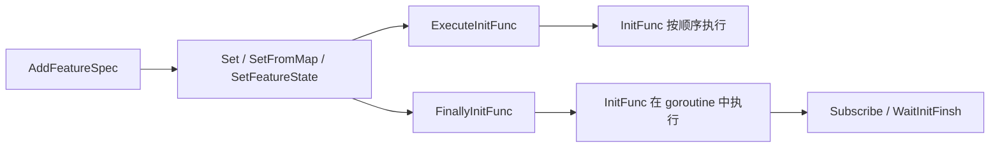

# FeatureGate

[中文](README.zh.md) | [English](README.md)

[](https://github.com/RealAlexandreAI/featuregate/actions/workflows/ci.yml)
[](go.mod)
[](LICENSE)

从 [MOSN](https://github.com/mosn/mosn) 的 [`pkg/featuregate`](https://github.com/mosn/mosn) 拆出来的一个小型 Go feature flag gate。它保存具名 feature spec、默认值，以及可选的锁定默认值，再按顺序或在后台调用每个 spec 的 `InitFunc`。

没有配置文件，没有网络调用，也没有进程级 `init()`。使用方自己构造 `FeatureGate`，注册 spec，设置状态，再手动启动初始化。

模块：`github.com/RealAlexandreAI/featuregate`（最新 tag `v0.0.1`）。Go 1.22。

## 运行方式



`ExecuteInitFunc` 同步执行，只处理你传入的 key。`FinallyInitFunc` 把 gate 切到 finally 阶段，并为每个尚未完成的已启用 spec 启动一个 goroutine。只有切换之后，`Subscribe` 才合法。

## 安装

```bash
go get github.com/RealAlexandreAI/featuregate@v0.0.1
```

## 用法

```go
package main

import (
	"fmt"
	"time"

	"github.com/RealAlexandreAI/featuregate"
)

type onFeature struct {
	featuregate.BaseFeatureSpec
	name string
}

func (f *onFeature) InitFunc() {
	fmt.Println("init", f.name)
}

func main() {
	fg := featuregate.NewFeatureGate()

	_ = fg.AddFeatureSpec("alpha", &onFeature{
		BaseFeatureSpec: featuregate.BaseFeatureSpec{DefaultValue: true},
		name:            "alpha",
	})
	_ = fg.AddFeatureSpec("beta", &onFeature{
		BaseFeatureSpec: featuregate.BaseFeatureSpec{DefaultValue: false},
		name:            "beta",
	})
	_ = fg.AddFeatureSpec("locked", &featuregate.BaseFeatureSpec{
		DefaultValue:    false,
		IsLockedDefault: true,
	})

	// 未知名称，以及非布尔值，都会返回错误。
	// IsLockedDefault 为真时，拒绝 DefaultValue 以外的值。
	if err := fg.Set("alpha=true,beta=true"); err != nil {
		panic(err)
	}

	fmt.Println(fg.Enabled("alpha")) // true
	fmt.Println(fg.Enabled("beta"))  // true
	fmt.Println(fg.Enabled("nope"))  // false：未知 key 被报为未启用

	// 同步，按给定顺序。未启用的 spec 会被跳过。
	// 不传 key 会把 gate 标记为已初始化，但不调用任何 InitFunc。
	fg.ExecuteInitFunc("alpha")

	// 剩下的已启用 spec（此处为 beta）在 goroutine 中运行。
	// 第二次调用不做任何事。
	fg.FinallyInitFunc()

	enabled, err := fg.Subscribe("beta", time.Second)
	if err != nil {
		panic(err)
	}
	fmt.Println("beta ready", enabled)

	if err := fg.WaitInitFinsh(); err != nil {
		panic(err)
	}
}
```

`example.go` 构造一个带三个 spec 的 gate。`example_test.go` 不能当作用法示例：其中对 `SetFromMap` 的断言与 `SetFromMap` 的实际行为不符（见[阶段与状态](#阶段与状态)）。

## API

| 符号 | 行为 |
| --- | --- |
| `NewFeatureGate() *FeatureGate` | 空 gate。阶段为 initialize。 |
| `AddFeatureSpec(key Feature, spec FeatureSpec) error` | 注册 `spec`。初始化之后返回 `ErrInited`。`key` 已注册时返回 `nil`，并保留已有 spec。 |
| `Set(value string) error` | 解析逗号分隔的 `name=bool`。空段被跳过。 |
| `SetFromMap(m map[string]bool) error` | 设置每个已知 key。遇到第一个错误即停止。map 的迭代顺序不固定，后续条目不保证会被写入。 |
| `SetFeatureState(key Feature, enable bool) error` | 设置一个已知 key。 |
| `Enabled(key Feature) bool` | 当前状态。未知 key 返回 `false`。 |
| `KnownFeatures() map[string]bool` | 名称到当前状态的副本。 |
| `ExecuteInitFunc(keys ...Feature)` | 设置 `inited`。对每个尚未完成且已启用的已知 key，在调用方 goroutine 上调用 `InitFunc`，然后关闭该 key 的 ready channel。未知 key 和已完成的 key 被跳过。 |
| `FinallyInitFunc()` | 仅一次：设置 `inited`，把阶段切到 finally，并为每个尚未完成的已启用 spec 启动 goroutine。未启用的 spec 不会被标记完成，其 ready channel 保持打开。 |
| `Subscribe(key Feature, timeout time.Duration) (bool, error)` | 仅 finally 阶段合法（否则 `ErrSubStage`）。未知 key 返回错误。未启用的 key 返回 `false, nil`，不等待。已启用的 key 一直等到其 ready channel 关闭，或到达 `timeout`（`0` 表示不设期限）。 |
| `WaitInitFinsh() error` | 等待 `FinallyInitFunc` 启动的 goroutine。若 gate 尚未初始化则返回 `ErrNotInited`。源码中的方法名就是这样拼写的。 |

`Feature` 是 `string`。`FeatureSpec` 是 spec 必须实现的接口。`BaseFeatureSpec` 是自带实现：`InitFunc` 为空，所以嵌入它并覆盖 `InitFunc`，才能让某个 flag 做实际工作。

| `BaseFeatureSpec` 字段 | 含义 |
| --- | --- |
| `DefaultValue` | 任何 `SetState` 之前返回的状态。 |
| `IsLockedDefault` | 为真时，`Set`、`SetFromMap`、`SetFeatureState` 拒绝 `DefaultValue` 以外的值。 |

`types.go` 中的错误：

| 错误 | 何时 |
| --- | --- |
| `ErrInited` | `inited` 已设置后调用 `AddFeatureSpec`、`Set`、`SetFromMap` 或 `SetFeatureState`。 |
| `ErrNotInited` | 初始化之前调用 `WaitInitFinsh`。内部 subscribe 查找在 gate 未初始化时也会返回它；`Subscribe` 会先碰到 `ErrSubStage`。 |
| `ErrSubStage` | 在 `FinallyInitFunc` 之前调用 `Subscribe`。 |

`setFeatureState` 还会返回普通的 `fmt.Errorf`：`feature %s is not registered`，以及 `feature %s is locked to %v`。

## 阶段与状态

| 调用 | 初始化前 | 仅调用过 `ExecuteInitFunc` | 调用过 `FinallyInitFunc` 之后 |
| --- | --- | --- | --- |
| `AddFeatureSpec`、`Set`、`SetFromMap`、`SetFeatureState` | 允许 | `ErrInited` | `ErrInited` |
| `Enabled`、`KnownFeatures` | 允许 | 允许 | 允许 |
| `ExecuteInitFunc` | 允许。设置 `inited`。 | 对尚未完成的 key 仍允许。 | 对尚未完成的 key 仍允许。不改变阶段。 |
| `FinallyInitFunc` | 允许。设置 `inited`，阶段切到 finally。 | 相同，针对尚未完成的 spec。 | 第一次之后为空操作。 |
| `Subscribe` | `ErrSubStage` | `ErrSubStage` | 允许 |
| `WaitInitFinsh` | `ErrNotInited` | 若未使用 `FinallyInitFunc` 则返回 nil（`WaitGroup` 为空）。 | 等待这些 goroutine。 |

容易看漏的状态规则：

- `Enabled` 使用 `State()`。在 `SetState` 之前，返回的是 `DefaultValue`。未知 key 为 `false`，这与“已知但默认值为 `false`”不是一回事。
- `KnownFeatures` 拷贝的是当前状态，不是 spec 的深拷贝。对另一个 gate 调用 `SetFromMap` 时，会把这份快照写到已注册的 key 上，其余 key 保持默认值。被设为 `false` 的 key 仍是 `false`，不会回退到 `DefaultValue`。
- `AddFeatureSpec` 不拷贝 spec。你传入的指针会被直接保存。
- `FinallyInitFunc` 不会从 `InitFunc` 的 panic 中恢复。
- 这里没有用 mutex 保护 `known`。先注册并设好状态，再启动初始化；不要从其他 goroutine 调用 setter。

## 许可证

Apache License 2.0。见 [LICENSE](LICENSE)。

Go 源文件保留了上游的 Apache 头部注释，其中指向一份 ASF `NOTICE` 文件。本仓库没有 `NOTICE` 文件。`LICENSE` 附录仍是 Apache 模板里未填写的 `[yyyy] [name of copyright owner]` 样板。
